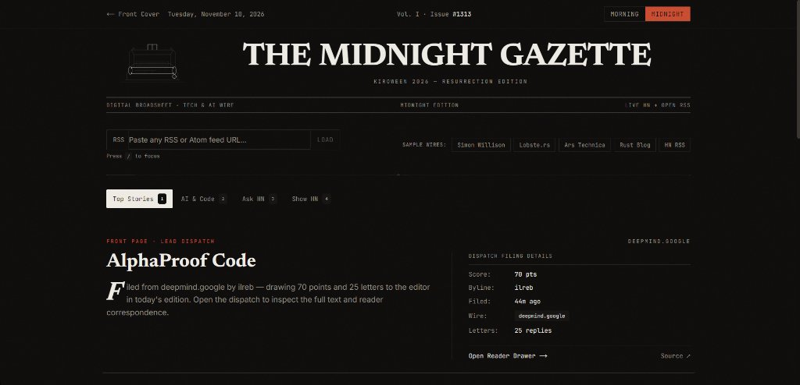

# The Midnight Gazette

> **Kiroween 2026 — Resurrection Track**  
> Resurrecting the classic printed broadsheet and Google Reader–era RSS into a fast, borderless tech & AI reader.



## What It Is

**The Midnight Gazette** brings back two forgotten web rituals—the tactile hierarchy of a printed morning newspaper and open, algorithm-free RSS feeds—paired with a **Morning Paper / Midnight Edition** theme switch.

### Judge Quick-Test Guide (60 Seconds)

1. **Front Cover & Isometric Newspaper:** Hover over the isometric SVG newspaper to fan the broadsheet sheets apart; click the newspaper (or `← Prev Page` / `Next Page →`) to flip pages back and forth.
2. **Flip Themes (`M`):** Toggle between **Morning Paper** (warm newsprint) and **Midnight Edition** (noir broadsheet).
3. **Enter the Gazette:** Click **Explore the Gazette →** (or any of the 3 *Inside Today's Edition* index columns).
4. **Test Live RSS in 1 Click:** Click any **Sample Wire** (*Simon Willison*, *Lobste.rs*, *Ars Technica*, *Rust Blog*, *HN RSS*) or press `/` and paste any public RSS/Atom URL.
5. **Read & Inspect:** Press `1–4` to switch Hacker News editions, click any story to open the **Reader Drawer** with top comments formatted as **Letters to the Editor**, and press `Esc` to close.

## Key Features

- **Portfolio Cover Hero + Interactive SVG Vector:** Asymmetric editorial cover with a custom 2:1 isometric broadsheet stack (`app/lib/iso/`).
- **4 Live Hacker News Editions:** Top Stories (`1`), AI & Code (`2`), Ask HN (`3`), Show HN (`4`).
- **Open RSS / Atom Wire (`POST /api/rss`):** Server-side XML/Atom parser supporting CDATA, entity decoding, and 1-click sample feeds.
- **Broadsheet Editorial Layout:** Double-rule masthead, 60/40 lead dispatch with drop cap, 3-column hairline grid, and paper-grain overlay.
- **Accessibility:** Full keyboard navigation (`1–4`, `M`, `/`, `Esc`) and `prefers-reduced-motion` support.

## Kiro Specs & Steering

- [`.kiro/steering/product.md`](.kiro/steering/product.md) — Resurrection vision & borderless editorial rules
- [`.kiro/specs/midnight-gazette/requirements.md`](.kiro/specs/midnight-gazette/requirements.md) — Functional & accessibility requirements
- [`.kiro/specs/midnight-gazette/design.md`](.kiro/specs/midnight-gazette/design.md) — Typography, color tokens, and isometric vector specs
- [`.kiro/specs/midnight-gazette/tasks.md`](.kiro/specs/midnight-gazette/tasks.md) — Completed implementation checklist & architecture

## Tech Stack

- **Framework:** Next.js 14 (App Router, TypeScript)
- **Styling:** Tailwind CSS + CSS custom properties (`Newsreader`, `Inter`, `JetBrains Mono`)
- **Vector Graphics:** Custom 2:1 isometric SVG engine (`app/lib/iso/iso.js`)
- **Data:** Hacker News Firebase API + `POST /api/rss` Route Handler

## Run Locally

```bash
pnpm install
pnpm dev
```

Open [http://localhost:3000](http://localhost:3000).

```bash
# Type-check & production build
npx tsc --noEmit
pnpm build
```

## License

MIT — see [LICENSE](LICENSE).
